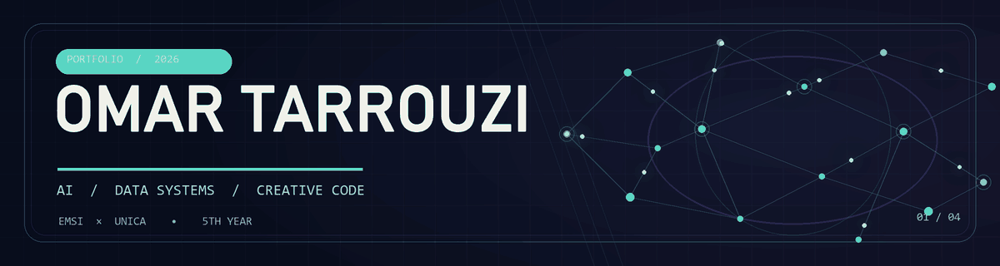

  
   
  <a href="https://linkedin.com/in/omar-tarrouzi-20493b367">LinkedIn</a> ·
  <a href="https://omar-tarrouzi.github.io/Projet-IA-r-active-break-the-silence/">Play ASCENT</a> ·
  <a href="https://github.com/Omar-Tarrouzi?tab=repositories">Projects</a>

### Hello, I'm Omar 👋

I'm a **fifth-year AI & Data Science engineering student at EMSI**, pursuing a **double-degree Master IA2 with UNICA**. I enjoy building the whole system: data ingestion and models, the APIs around them, and an interface people actually want to use.

My work moves between **distributed data**, **multi-agent AI**, and **creative coding**. I care about useful results, clear behaviour, and the engineering behind the demo.

### Selected work

| Project | What it does | Built with |
| :--- | :--- | :--- |
| **[ASCENT — Break the Silence](https://github.com/Omar-Tarrouzi/Projet-IA-r-active-break-the-silence)** · [Play ↗](https://omar-tarrouzi.github.io/Projet-IA-r-active-break-the-silence/) | A browser game where steering-behaviour swarms form weapons, attack, and break apart under sonic blasts. | JavaScript · p5.js · steering behaviours |
| **[Savings eligibility pipeline](https://github.com/Omar-Tarrouzi/big-data-project)** | Containerized ingestion, transformation, model training, and batch scoring for a data engineering and ML project. | PySpark · Airflow · NiFi · MinIO · Docker |
| **[Medical Agent](https://github.com/Omar-Tarrouzi/Medical-Agent)** | A multi-agent clinical-orientation prototype with human validation and an API. | LangGraph · LangChain · FastAPI |
| **[SmartNotes](https://github.com/Omar-Tarrouzi/PFA-note--making-Pipeline-Automatis-de-Notes-de-Cours-par-Vision-Num-rique-et-LLM)** | Turns photos of class notes into structured PDF summaries using OCR and language models. | OCR · n8n · LLMs |

### What I work with

**Data & ML** · Python, SQL, PySpark, Spark MLlib, Airflow, ETL, data modelling  
**AI applications** · LangGraph, LangChain, FastAPI, RAG, OCR  
**Products & infrastructure** · JavaScript, React / React Native, Flask, Docker, PostgreSQL, MongoDB

### The path so far

- **2026 · Data Engineering & ML internship, Banque Centrale Populaire** — worked in a pair on a Big Data pipeline for savings-product eligibility.
- **2025 · Web development internship, Artiflow** — website redesign and performance audit.
- **Now · EMSI × UNICA** — fifth year of AI & Data Science engineering and the Master IA2 double-degree path.

  Building systems that are useful, understandable, and a little more alive.

